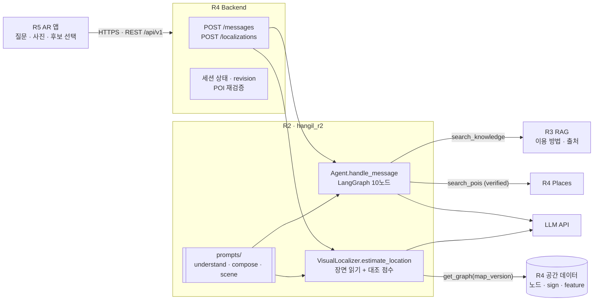

# 설계서 STEP 05 · AI 설계 (R2 담당 부분)

> 기준: 팀 명세 v0.3 (2026-10-22). 구성도의 R2 밖 요소(R3 · R4 · R5)는 명세 1장 소유권을 따른다.

## 1. 시스템 구성도 (R2 중심)



## 2. AI 처리 흐름

**A. 질문 → 목적지 (`handle_message`)**
1. 입력: 질문 + `SessionContext`(언어 · 지도 · 최근 대화) + 화면에서 고른 `selected_poi_id`
2. `understand` (LLM): 의도 5종 + 주제 + 슬롯(열차 종류 · 행선지 · 결제 수단) + "잘 모르겠어요" 여부 + 검색어 + 위험 여부
3. `fill_slots`: 이전 슬롯과 합치고, 되묻던 질문의 짧은 대답("직통열차")을 원래 의도로 이어 붙인다. 승차권 주제면 `train_type` 이 필수
4. 분기
   - 위험 · 범위 밖 → `denied` (되묻는 중이어도 이어 붙이지 않음)
   - "길 잘못 든 것 같아" → `needs_location`
   - 화면 선택 → `verify_selected`: `search_pois` 로 verified 확인
   - 필수 슬롯 빠짐 → `ask_slot`: "직통열차와 일반열차 중 어떤 승차권인가요?" [직통열차] [일반열차] [잘 모르겠어요]
   - "잘 모르겠어요" → `explain_options`: R3 비교 자료로 차이 설명 + 다시 선택 (자료 없으면 설명 없이 선택만)
   - 되묻기 2회 초과 → `find_poi`: 매표소 목록 버튼으로 직접 선택
   - 길 안내 → `find_poi`: 검증된 POI 1개면 `destination_set`, 여러 개면 `needs_clarification` + 추천 버튼, 0개면 다시 묻기
   - 이용 방법 → `retrieve`(R3) → `compose`(LLM, 자료 내용만 · 번호 인용) → `answered` / 근거 없으면 `needs_review`
   - 티켓 구매 + 길 안내 → 위 두 단계를 차례로 → 답변 + 목적지 (검색어에 슬롯 이름을 붙여 해당 열차 자료 · 매표소만 찾음)
5. 출력 규격 검증(Pydantic) 후 Backend 로 반환. 되묻는 중이면 `slots` 에 `pending_intent` 를 담아 Backend 가 다음 요청에 돌려줌

**대화 예시 (공항철도 승차권)**

| 턴 | 사용자 | 노드 | 응답 |
|---|---|---|---|
| 1 | 공항 가는 티켓 어디서 사? | understand → fill_slots → ask_slot | needs_clarification · [직통열차] [일반열차] [잘 모르겠어요] · slots: pending |
| 2 | 잘 모르겠어요 | → explain_options | needs_clarification · 비교 자료 요약 [1] · [직통열차] [일반열차] |
| 3 | 직통열차 | → retrieve → compose → find_poi | destination_set · 구매 방법 [1] + "직통열차 승차권 판매처로 안내할게요" · slots: {train_type: express} |

**B. 사진 → 위치 후보 (`estimate_location`)**: [docs/localization.md](localization.md)

**예외 처리**

| 상황 | 처리 | 결과 |
|---|---|---|
| LLM 응답 형식 위반 | 보류 | `needs_review` |
| 답변 문장에 인용 번호 없음 · 범위 밖 | 자료 제목만 안내 (폴백) | `answered` + sources |
| 검증 안 된 · 없는 POI | 목적지로 쓰지 않음 | `needs_clarification` |
| 추가 질문 2회 초과 | 목록 직접 선택 유도 | `needs_clarification` |
| 사진 단서 0건 · 장면 읽기 실패 | 재촬영 요청 | `no_match` |
| 이미지 형식 · 크기 위반 | `InvalidImage` | Backend 413/415 |
| 지도 버전 불일치 | `MapVersionMismatch` | Backend 409 |
| LLM · Tool 장애 | `LLMUnavailable` · `ToolUnavailable` | Backend 503 |

## 3. 기술 선택 근거

| 기술 | 역할 | 선택 근거 |
|---|---|---|
| LLM | 의도 · 검색어 추출, 근거 기반 답변 문장 | 자연어 · 다국어 질문을 규칙만으로 처리하기 어려움 |
| Vision LLM | 사진 속 글자 · 시설 읽기 | 지하 GPS 부정확, 표지판 글자가 가장 강한 위치 단서. 별도 OCR 모델 학습 없이 다국어 표지판 판독 |
| 규칙 기반 대조 + IDF | 위치 후보 순위 | LLM 에게 위치를 직접 묻지 않아 환각 차단. 점수 · 근거를 설명할 수 있음 |
| LangGraph | 의도별 분기, 검색 → 생성 → 목적지 순서 | 분기 · 순서가 코드와 그림에서 같은 이름으로 관리됨 (구성도 = 코드) |
| Pydantic | 계약 · 출력 규격 검증 | 모델이 규격을 어겨도 Backend 로 넘어가기 전에 차단 |

## 4. AI 출력 규격 (`hangil_r2/contracts.py`)

```json
{
  "status": "needs_clarification | destination_set | answered | needs_review | needs_location | denied",
  "intent": "navigate_to_poi | ask_procedure | ticket_purchase_and_navigation | report_lost | out_of_scope",
  "assistant_message": "1~800자",
  "destination": {"poi_id": "verified POI 만", "display_name": "..."} | null,
  "suggested_replies": [{"label": "...", "selected_poi_id": "..." | null}],
  "sources": [{"document_id": "...", "title": "...", "source_url": "...", "verified_at": "..."}],
  "next_action": "reply | locate | navigate | none",
  "slots": {"train_type": "express | general", "pending_intent": "되묻는 중일 때만", "pending_topic": "..."}
}
```

규칙
1. `destination_set` 일 때만 `destination` 이 있다.
2. `answered` 는 `sources` 1개 이상.
3. `needs_review` · `denied` · `needs_location` 에는 `sources` · `suggested_replies` 없음.
4. 상태별 `next_action` 고정: clarification → reply, destination_set → locate(위치 미확정) / navigate(확정), needs_location → locate, 나머지 → none.

`LocationEstimate`: `status: needs_confirmation | no_match`, 후보 최대 3개(rank_score 내림차순), `no_match` 는 후보 0개, [제안] `hint`.

## 5. Mini-project ① 활용 내역
해당 없음 (신규 기획)
