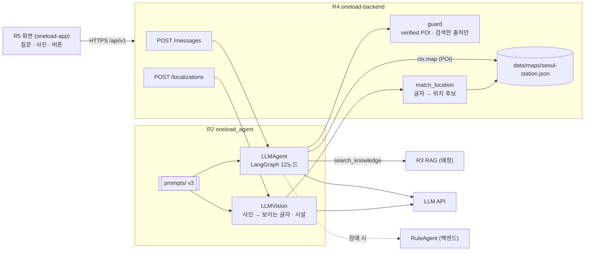

# 설계서 STEP 05 · AI 설계 (R2 담당 부분)

> 기준: 팀 명세 v0.3 + oneload-backend `app/ai/contracts.py` (`0019f55`, 2026-10-22).
> 구성도의 R2 밖 요소(R3 · R4 · R5)는 명세 1장 소유권을 따른다.

## 1. 시스템 구성도 (R2 중심)



## 2. AI 처리 흐름

**A. 대화 (`LLMAgent.handle_message`)**
1. 입력: 질문 + (선택) 사진 + 세션 문맥(`AgentContext`: 언어 · 지도 · 확정 위치 · 슬롯 · 최근 대화 10개)
2. `read_photo`: 사진이 있으면 `LLMVision` 으로 보이는 글자 · 시설 요약 (예: 발매기)
3. `understand` (LLM): 의도 6종 · 주제 · 슬롯(열차 종류 · 교통카드 유무) · '잘 모르겠어요' · 위험 여부
4. `update_slots`: 세션 슬롯에 이번 대답을 합침 → 짧은 대답("직통열차", "없어요")도 이어서 처리
5. 분기 (코드가 결정)

| 조건 | 노드 | 결과 |
|---|---|---|
| 위험 · 범위 밖 | `deny` | out_of_scope |
| "길을 잘못 들었어" | `relocalize` | relocalize · locate |
| 화면 버튼(selected_poi_id) | `select_poi` | verified POI 면 destination_set |
| 열차 종류 모름 | `ask_train` | [직통열차] [일반열차] [잘 모르겠어요] |
| "잘 모르겠어요" | `explain_options` | R3 자료로 차이 설명 (자료 없으면 비교하지 않음) |
| 일반열차 + 카드 모름 | `ask_card` | [교통카드 있어요] [없어요] [교통카드가 뭐예요?] |
| 이용 방법 · 결제 | `answer` | 자료 있으면 answered + 출처, 없으면 cannot_answer |
| 열차 · 카드 확정 | `arex_destination` | 직통 → 직통 표 사는 곳 / 일반+카드 없음 → 일반 표 사는 곳 / 일반+카드 있음 → 일반 승강장 |
| 그 밖의 장소 | `find_poi` | 지도 검색 1건 → 목적지, 여러 건 → 버튼 |

6. 백엔드 `guard` 가 목적지(verified POI) · 출처(이번에 검색한 문서)를 한 번 더 검사

**B. 사진 위치 (`LLMVision.extract` → 백엔드 `match_location`)**: [docs/localization.md](localization.md)

**대화 예시** (백엔드를 로컬에서 띄워 실제 API 로 확인, FakeLLM · 데모 문서)

| 턴 | 손님 | 한길 (status · 세션 state) |
|---|---|---|
| 1 | 공항 가는 티켓 어디서 사? | 인천공항까지는 공항철도 열차가 두 종류예요. 어떤 열차로 갈까요? (needs_clarification) |
| 2 | 잘 모르겠어요 | (데모 자료 요약 [1]) 어떤 열차로 안내할까요? (needs_clarification) |
| 3 | 일반열차 | 일반열차는 개찰구에서 교통카드를 찍어요. 교통카드가 있나요? (needs_clarification) |
| 4 | 없어요 | (구매 방법 [1]) 일반열차 표 사는 곳으로 안내할게요. B3에 있어요. 먼저 주변 안내판을 찍어서… (destination_set · needs_location) |
| 사진 | (공항철도 · 4호선 안내판) | 후보 line4-gates, line1-gates (needs_confirmation) → 확정 후 ready_to_navigate |

## 3. 기술 선택 근거

| 기술 | 역할 | 선택 근거 |
|---|---|---|
| LLM | 의도 · 슬롯 이해, 자료 기반 문장 | 짧은 대답 · 다국어 · 다양한 표현을 키워드 규칙(RuleAgent)보다 넓게 이해 |
| Vision LLM | 사진 속 글자 · 시설 읽기 | 별도 OCR 학습 없이 한 · 영 표지판 판독. 위치 판단은 하지 않음 |
| LangGraph | 슬롯 · 의도에 따른 분기 | 분기 이름이 그림과 코드에서 같음 (구성도 = 코드) |
| Pydantic + 백엔드 guard | 출력 규격 검증 | LLM 이 규격을 어기거나 목적지 · 출처를 지어내도 화면에 닿기 전에 차단 |
| RuleAgent 대체 | 장애 시 응답 | LLM 장애에도 시연 · 서비스가 멈추지 않음 |

## 4. AI 출력 규격 (백엔드 `AgentResponse` 그대로)

```json
{
  "status": "answered | needs_clarification | destination_set | relocalize | cannot_answer | out_of_scope",
  "intent": "navigate_to_poi | ticket_purchase_and_navigation | payment_question | usage_question | report_off_route | out_of_scope",
  "assistant_message": "...", "items": [], "tip": null, "unverified_notes": [],
  "slots": {"train_type": "express | allstop | unknown", "has_transit_card": "yes | no | unknown"},
  "destination": {"poi_id": "verified POI 만"} | null,
  "suggested_replies": [{"label": "...", "selected_poi_id": "..." | null}],
  "sources": [{"document_id": "...", "title": "...", "source_url": null, "verified_at": "..."}],
  "next_action": "reply | locate | confirm_location | navigate | recapture | none"
}
```

R2 규칙 (백엔드 guard 위에 추가로 지키는 것)
1. 목적지는 열차 종류 · 분류로 지도의 verified POI 에서 찾는다 (POI id 를 코드에 박지 않음)
2. 이용 방법 · 결제 답은 이번에 검색된 자료가 있을 때만. 요금은 `scope="fare"` 자료만 근거
3. 자료가 없으면 `cannot_answer`, 비교 자료가 없으면 `unverified_notes` 에 "확인 전" 표시
4. 다른 열차 전용 자료를 근거로 붙이지 않는다 (검색 시 슬롯 전달)

## 5. Mini-project ① 활용 내역
해당 없음 (신규 기획)
